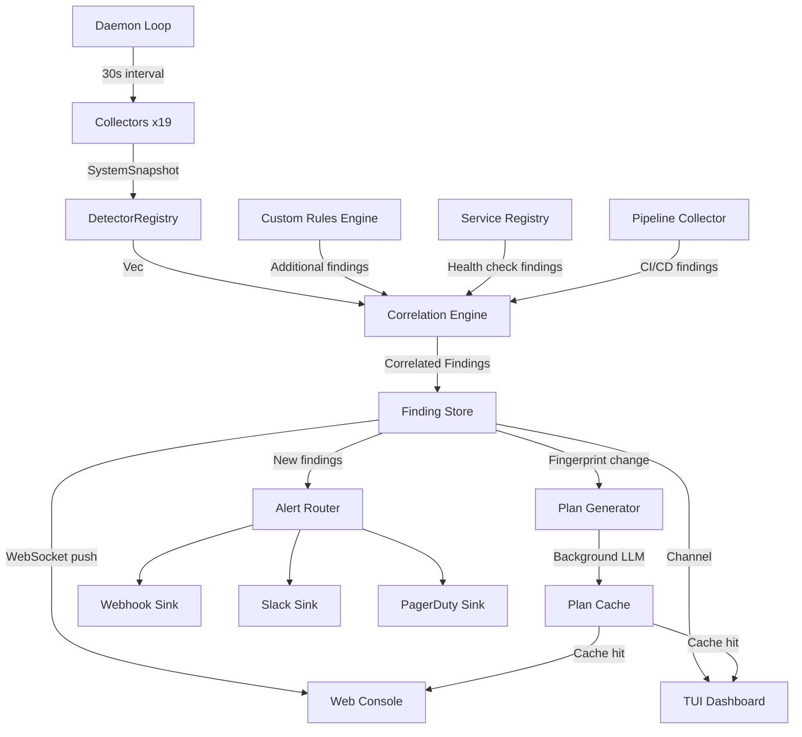

# Design Document: HELMOPS Rebirth v2

## Overview

HELMOPS Rebirth v2 transforms the existing 6-crate workspace into a focused 5-crate monitoring console by removing the `helm-tools` crate and dead agent-era code from `helm-memory`. The result is a TUI-first and web-first Linux monitoring/troubleshooting console that identifies problems within 5 seconds of opening, provides pre-built fix plans, and maintains a tamper-proof audit trail.

The architecture follows a daemon-driven pipeline: continuous collection → detection → correlation → finding generation → dashboard rendering. LLM integration is limited to narrative/fix plan generation (no autonomous agent loops). The security spine (HMAC audit chain, capability gates, taint propagation, secrets store) is preserved intact.

**Key design goals:**
- Single binary (`helmops`) with two entry points: web console (default) and TUI (`helmops tui`)
- 5-second problem identification via single-line summary and severity-ordered findings
- Pre-built fix plans cached by fingerprint with ≥80% cache hit ratio
- Fleet monitoring via parallel SSH (20 hosts in ≤2s)
- Custom service registration and detection rules without code changes
- Correlation engine for root cause analysis
- Mobile-responsive web console with WebSocket live updates

## Architecture

### Post-Consolidation Workspace (5 Crates)

```
helm/
├── Cargo.toml                    # workspace root
├── crates/
│   ├── helm-core/                # Shared types (unchanged)
│   │   └── src/
│   │       ├── capability.rs     # Capability enum, GrantScope
│   │       ├── taint.rs          # TaintLevel, Tainted<T>
│   │       ├── message.rs        # Role, ContentBlock, Message
│   │       ├── error.rs          # HelmError variants
│   │       ├── secret.rs         # SecretStore, redact_secrets()
│   │       └── validation.rs     # Validator
│   ├── helm-providers/           # LLM backends (plan generation only)
│   │   └── src/
│   │       ├── provider.rs       # Provider trait, ChatRequest/Response
│   │       ├── anthropic.rs      # Anthropic Claude
│   │       ├── openai_compat.rs  # Groq, OpenRouter, NvidiaNim
│   │       ├── gemini.rs         # Google Gemini
│   │       ├── ollama.rs         # Local Ollama
│   │       └── mock.rs           # Test mock
│   ├── helm-memory/              # SQLite persistence (trimmed)
│   │   └── src/
│   │       ├── episodes.rs       # EpisodeRecord, AuditEventRecord, CapabilityGrantRecord
│   │       ├── snapshots.rs      # SnapshotStore
│   │       ├── finding_state.rs  # FindingStateStore
│   │       ├── changesets.rs     # ChangeSetStore
│   │       └── plans.rs          # TroubleshootingPlanStore
│   └── helm-monitor/            # Core runtime (expanded)
│       └── src/
│           ├── collectors/       # 17 existing + 2 new (pipeline, custom_service)
│           ├── detectors/        # 34 existing + custom rule engine
│           ├── alerting/         # Webhook, Slack, PagerDuty sinks
│           ├── correlation.rs    # NEW: Correlation engine
│           ├── custom_rules.rs   # NEW: Custom detection rules
│           ├── custom_service.rs # NEW: Service registry + health checks
│           ├── pipeline.rs       # NEW: CI/CD pipeline collector
│           ├── engine.rs         # AlertingEngine orchestrator
│           ├── execute.rs        # Execution engine (std::process only)
│           ├── findings.rs       # Finding model
│           ├── snapshot.rs       # SystemSnapshot model
│           └── troubleshoot.rs   # Plan generation
└── helm-cli/                    # Binary entry point
    └── src/
        ├── main.rs              # CLI + daemon + subcommands
        ├── tui.rs               # Terminal dashboard (ratatui)
        ├── web.rs               # Web console (axum + WebSocket)
        └── web/
            └── dashboard.html   # Single-file web frontend
```

### Data Flow



### Daemon Architecture

The daemon is a single `tokio` runtime that orchestrates the collection-detection-alert pipeline:

```rust
// Simplified daemon loop
loop {
    let snapshot = collect_snapshot(profile).await;        // 17+ collectors via tokio::join!
    let mut findings = detector_registry.detect(&snapshot, domains, previous.as_ref());
    findings.extend(custom_rules.evaluate(&snapshot));     // Custom rules
    findings.extend(service_registry.check_health().await); // Custom services
    let correlated = correlation_engine.correlate(&findings, &history);
    
    // Background plan generation for new fingerprints
    for finding in &correlated {
        plan_cache.ensure_plan(finding, &provider).await;
    }
    
    // Alert routing
    for finding in &correlated {
        alert_router.route(finding).await;
    }
    
    // Push to dashboards
    broadcast_tx.send(snapshot_json);
    
    previous = Some(snapshot);
    tokio::time::sleep(refresh_interval).await;
}
```

## Components and Interfaces

### 1. Collector Trait (Existing, Extended)

```rust
/// Common trait for all collectors (unchanged).
#[allow(async_fn_in_trait)]
pub trait Collector: Send + Sync {
    type Output: Send;
    fn domain(&self) -> &'static str;
    async fn collect(self, profile: MonitorProfile) -> Result<Self::Output, CollectorError>;
}
```

New collectors added:
- `PipelineCollector` — monitors CI/CD endpoints
- `CustomServiceCollector` — health checks registered services

### 2. Detector Trait (Existing, Unchanged)

```rust
pub trait Detector: Send + Sync {
    fn id(&self) -> &'static str;
    fn domain(&self) -> MonitorDomain;
    fn detect(&self, snapshot: &SystemSnapshot, previous: Option<&SystemSnapshot>) -> Vec<Finding>;
}
```

### 3. Custom Rules Engine (New)

```rust
/// A single custom detection rule parsed from rules.toml.
pub struct CustomRule {
    pub id: String,
    pub title: String,
    pub severity: Severity,
    pub condition: RuleCondition,
    pub impact: String,
    pub fix_hint: Option<String>,
}

pub enum RuleCondition {
    Simple {
        metric_path: String,       // e.g., "load.load_average.one"
        operator: CompareOp,       // gt, lt, eq, ne, contains, matches
        threshold: ThresholdValue, // numeric, string, or regex
    },
    Compound {
        logic: LogicOp,            // And, Or
        conditions: Vec<RuleCondition>,
    },
    Rate {
        metric_path: String,
        count_threshold: u32,
        window_seconds: u64,
    },
}

pub enum CompareOp { Gt, Lt, Eq, Ne, Contains, Matches }
pub enum LogicOp { And, Or }
pub enum ThresholdValue { Numeric(f64), Text(String), Regex(String) }

pub struct CustomRulesEngine {
    rules: Vec<CustomRule>,
}

impl CustomRulesEngine {
    /// Load and validate rules from rules.toml. Returns errors with line numbers.
    pub fn load(path: &Path) -> Result<Self, Vec<RuleValidationError>>;
    
    /// Evaluate all rules against the current snapshot.
    pub fn evaluate(&self, snapshot: &SystemSnapshot) -> Vec<Finding>;
    
    /// Hot-reload rules from disk (called each daemon cycle).
    pub fn reload(&mut self, path: &Path) -> Result<(), Vec<RuleValidationError>>;
}
```

### 4. Custom Service Registry (New)

```rust
pub enum ServiceType {
    DockerContainer { name_or_label: String },
    Database { kind: DbKind, connection_string: String },
    Kubernetes { kubeconfig_path: PathBuf },
    Pipeline { endpoint: String },
    WebServer { url: String, expected_status: u16 },
    TcpEndpoint { host: String, port: u16 },
    HttpEndpoint { url: String },
}

pub enum DbKind { PostgreSQL, MySQL, Redis, MongoDB }

pub struct RegisteredService {
    pub id: String,
    pub name: String,
    pub service_type: ServiceType,
    pub environment: String,       // production, staging, development, or custom
    pub team: String,              // owning team label
    pub consecutive_failures: u32,
    pub last_healthy: Option<DateTime<Utc>>,
}

pub struct ServiceRegistry {
    services: Vec<RegisteredService>,
    config_path: PathBuf,
}

impl ServiceRegistry {
    /// Load from services.toml (atomic read).
    pub fn load(path: &Path) -> Result<Self, ServiceRegistryError>;
    
    /// Add a new service. Validates and persists atomically.
    pub fn add(&mut self, service: RegisteredService) -> Result<(), ServiceRegistryError>;
    
    /// Remove a service by ID.
    pub fn remove(&mut self, id: &str) -> Result<(), ServiceRegistryError>;
    
    /// Run health checks for all registered services. Returns findings.
    pub async fn check_health(&mut self) -> Vec<Finding>;
    
    /// Persist to services.toml via atomic write (temp + rename, mode 0600).
    fn persist(&self) -> Result<(), std::io::Error>;
}
```

### 5. Correlation Engine (New)

```rust
pub struct CorrelationGroup {
    pub id: String,
    pub root_cause: Finding,
    pub effects: Vec<Finding>,
    pub causal_chain: Vec<CausalLink>,
}

pub struct CausalLink {
    pub from_fingerprint: String,
    pub to_fingerprint: String,
    pub relationship: CausalRelationship,
}

pub enum CausalRelationship {
    ResourceDependency,   // e.g., disk full → service crash
    TemporalPrecedence,   // A consistently precedes B
    SharedResource,       // same affected_resource
}

pub struct CorrelationEngine {
    /// Temporal history: fingerprint → Vec<timestamp>
    history: HashMap<String, VecDeque<Instant>>,
    /// Known resource dependencies
    dependency_graph: HashMap<String, Vec<String>>,
    /// Configurable temporal window
    temporal_window: Duration,
}

impl CorrelationEngine {
    pub fn new(temporal_window: Duration) -> Self;
    
    /// Correlate findings, grouping related ones under root causes.
    pub fn correlate(
        &mut self,
        findings: &[Finding],
        snapshot: &SystemSnapshot,
    ) -> Vec<CorrelationGroup>;
    
    /// Register a known resource dependency (e.g., "/var" → "nginx.service").
    pub fn add_dependency(&mut self, resource: &str, dependent: &str);
}
```

### 6. Plan Cache (Existing, Formalized)

```rust
pub struct PlanCache {
    cache: Arc<DashMap<String, PlanState>>,
    ttl: Duration,
}

pub enum PlanState {
    Generating,
    Ready(TroubleshootingPlan),
    Failed(String),
}

impl PlanCache {
    pub fn new(ttl: Duration) -> Self;
    
    /// Get cached plan for a fingerprint. Returns None if not cached.
    pub fn get(&self, fingerprint: &str) -> Option<&PlanState>;
    
    /// Spawn background plan generation if not already cached/generating.
    pub async fn ensure_plan(
        &self,
        finding: &Finding,
        provider: &dyn Provider,
        snapshot: &SystemSnapshot,
    );
    
    /// Evict expired entries.
    pub fn evict_expired(&self);
}
```

### 7. Ring Buffer for Metrics (New)

```rust
/// Fixed-size circular buffer for metric history.
pub struct RingBuffer<T> {
    data: Vec<T>,
    head: usize,
    len: usize,
    capacity: usize,
}

impl<T: Copy + Default> RingBuffer<T> {
    pub fn new(capacity: usize) -> Self;
    pub fn push(&mut self, value: T);
    pub fn iter(&self) -> impl Iterator<Item = &T>;
    pub fn len(&self) -> usize;
    pub fn is_empty(&self) -> bool;
}

/// Metrics tracked per refresh cycle.
pub struct MetricHistory {
    pub cpu_percent: RingBuffer<f64>,
    pub memory_percent: RingBuffer<f64>,
    pub disk_percent: RingBuffer<f64>,
    pub network_rx_bytes: RingBuffer<u64>,
    pub network_tx_bytes: RingBuffer<u64>,
    pub load_1m: RingBuffer<f64>,
    pub swap_percent: RingBuffer<f64>,
    pub io_pressure: RingBuffer<f64>,
}
```

### 8. Fleet Parallel Collection (Existing, Formalized)

```rust
pub struct RemoteRegistry {
    pub remotes: Vec<RemoteEntry>,
}

pub struct RemoteEntry {
    pub host_id: Uuid,
    pub name: String,
    pub address: String,
    pub credential: Credential,
}

pub enum Credential {
    SshAgent,
    KeyFile(PathBuf),
    Password(Secret),  // Never persisted to disk
}

impl RemoteRegistry {
    /// Collect from all hosts concurrently via tokio::JoinSet.
    /// Returns within 2s timeout for 20 hosts.
    pub async fn parallel_collect_reports(&self) -> Vec<(Uuid, Result<MonitorReport, RemoteError>)>;
}
```

### 9. Web Console Architecture

```
┌─────────────────────────────────────────────────────────┐
│  Browser (dashboard.html — single file, no build step)  │
│  ┌───────────────────────────────────────────────────┐  │
│  │  WebSocket ← JSON LiveSnapshot every 5s           │  │
│  │  Keyboard shortcuts (1-9, Enter, Esc, F5, Alt+G)  │  │
│  │  Card-based layout, mobile-responsive (≥320px)    │  │
│  │  Touch targets ≥44x44px, font ≥14px               │  │
│  └───────────────────────────────────────────────────┘  │
└─────────────────────────────────────────────────────────┘
         │ WebSocket (ws://host:9120/ws)
         ▼
┌─────────────────────────────────────────────────────────┐
│  Axum HTTP Server (port 9120)                           │
│  Routes:                                                │
│    GET  /           → serve dashboard.html              │
│    GET  /ws         → WebSocket upgrade                 │
│    GET  /api/snapshot → JSON snapshot                   │
│    POST /api/refresh  → trigger daemon refresh          │
│    POST /api/plan     → generate/fetch plan             │
│  Background: broadcast channel → all WS clients         │
└─────────────────────────────────────────────────────────┘
```

### 10. TUI Layout Design

```
┌──────────────────────────────────────────────────────────────────────────────┐
│ HELMOPS │ myhost │ Linux 6.8.0 │ up 14d │ fleet: 12/12 up │ 14:32 UTC │ AI:✓│
├──────────────────────────┬───────────────────────────────────────────────────┤
│ ▌ALERTS│Services│Resources│Logs│Fleet│Changes│                               │
├──────────────────────────┼───────────────────────────────────────────────────┤
│ ── CRITICAL (2) ──────── │ WHEN: 2024-01-15 14:28 UTC (4m ago)              │
│ ● Disk /var is 94% full  │ WHERE: /var (ext4, 500GB)                        │
│ ● nginx returning 5xx    │ WHAT: Filesystem usage at 94%, 30GB remaining    │
│                           │   Evidence: df reports 470G/500G used            │
│ ── WARNING (3) ────────── │ WHY: /var/log growing at 2GB/day, no rotation   │
│ ● Redis memory at 85%    │ IMPACT: Service writes will fail within ~15h     │
│ ● 3 stale backups        │   Affected: nginx, postgres, redis               │
│ ● cert expires in 7d     │ FIX: [Plan ready]                                │
│                           │   1. Rotate logs: journalctl --vacuum-size=1G    │
│ ── INFO (1) ──────────── │   2. Clean apt cache: apt-get clean              │
│ ● 12 security updates    │   3. Verify: df -h /var                          │
│                           │                                                   │
│ ▁▂▃▅▇█▇▅▃▂ cpu  42%     │ [Enter] Apply plan  [r] Refresh  [?] Help        │
│ ▅▅▅▆▆▇▇▇▇█ mem  78%     │                                                   │
│ ████████████ disk 94%     │                                                   │
│ ▁▁▂▁▁▁▂▃▂▁ net  12MB/s  │                                                   │
│ ▂▃▃▄▃▃▂▂▃▃ load 2.4     │                                                   │
├──────────────────────────┴───────────────────────────────────────────────────┤
│ [1-6]Tab [↑↓]Select [Enter]Detail [a]Apply [r]Refresh │ Next: 26s │ 14:32 UTC│
└──────────────────────────────────────────────────────────────────────────────┘
```

**Narrow terminal (< 120 cols):** Collapses to single-pane list; Enter shows detail overlay.
**Minimum terminal:** 60×10 required; below that shows "larger terminal required" message.

## Data Models

### SystemSnapshot (Existing, Extended)

```rust
pub struct SystemSnapshot {
    pub id: String,
    pub host: HostIdentity,
    pub collected_at: DateTime<Utc>,
    pub profile: MonitorProfile,
    pub domains: SnapshotDomains,
    pub collector_errors: Vec<CollectorError>,
    pub redaction_version: String,
}

pub struct SnapshotDomains {
    pub host: HostIdentity,
    pub load: LoadSnapshot,
    pub disks: DiskSnapshot,
    pub services: ServiceSnapshot,
    pub containers: ContainerSnapshot,
    pub ports: PortSnapshot,
    pub logs: LogSnapshot,
    pub backups: BackupSnapshot,
    pub packages: PackageSnapshot,
    pub timers: TimerSnapshot,
    pub network: NetworkSnapshot,
    pub processes: ProcessSnapshot,
    pub firewall: FirewallSnapshot,
    pub kubernetes: KubernetesSnapshot,
    pub libvirt: LibvirtSnapshot,
    pub compose: ComposeSnapshot,
    pub certs: CertsSnapshot,
    // NEW domains:
    pub pipelines: PipelineSnapshot,       // CI/CD pipeline status
    pub custom_services: CustomServiceSnapshot, // Registered service health
}
```

### Finding (Existing, Unchanged)

```rust
pub struct Finding {
    pub id: FindingId,
    pub detector_id: String,
    pub fingerprint: String,
    pub snapshot_id: SnapshotId,
    pub severity: Severity,
    pub confidence: Confidence,
    pub category: MonitorDomain,
    pub title: String,
    pub affected_resource: String,
    pub evidence: Vec<EvidenceRef>,
    pub assumptions: Vec<String>,
    pub missing_data: Vec<String>,
    pub impact: String,
    pub read_only_checks: Vec<String>,
    pub fix_plan: Option<String>,
    pub lifecycle: FindingLifecycle,
}
```

### Configuration File Formats

**thresholds.toml** (`$XDG_CONFIG_HOME/helm/thresholds.toml`):
```toml
refresh_interval_secs = 30
sparkline_history_depth = 60

[detectors]
disabled = ["desktop_notify", "monitoring_health"]

[detectors.disk_usage]
warning_percent = 80
critical_percent = 90

[detectors.high_load]
warning_multiplier = 2.0
critical_multiplier = 4.0

[detectors.memory_pressure]
warning_percent = 80
critical_percent = 95

[detectors.cert_expiry]
warning_days = 30
critical_days = 7
```

**services.toml** (`$XDG_CONFIG_HOME/helm/services.toml`):
```toml
[[service]]
id = "prod-postgres"
name = "Production PostgreSQL"
type = "database"
kind = "postgresql"
connection_string = "postgres://monitor@db.internal:5432/app"
environment = "production"
team = "platform"

[[service]]
id = "staging-api"
name = "Staging API"
type = "http_endpoint"
url = "https://staging-api.internal/health"
expected_status = 200
environment = "staging"
team = "backend"

[[service]]
id = "deploy-pipeline"
name = "Main Deploy Pipeline"
type = "pipeline"
endpoint = "https://ci.internal/api/v4/projects/1/pipelines"
environment = "production"
team = "devops"
```

**rules.toml** (`$XDG_CONFIG_HOME/helm/rules.toml`):
```toml
[[rule]]
id = "high-swap-io"
title = "Swap I/O pressure is elevated"
severity = "warning"
impact = "Application performance degraded due to swap thrashing"
fix_hint = "Identify memory-hungry processes with `ps aux --sort=-%mem | head`"

[rule.condition]
type = "simple"
metric_path = "load.memory_pressure.avg10"
operator = "gt"
threshold = 25.0

[[rule]]
id = "too-many-containers"
title = "Container count exceeds capacity"
severity = "warning"
impact = "Host may run out of resources with too many containers"

[rule.condition]
type = "compound"
logic = "and"

[[rule.condition.conditions]]
type = "simple"
metric_path = "containers.containers.len"
operator = "gt"
threshold = 50

[[rule.condition.conditions]]
type = "simple"
metric_path = "load.memory.available"
operator = "lt"
threshold = 1073741824  # 1GB

[[rule]]
id = "error-spike"
title = "Journal error rate spike detected"
severity = "critical"
impact = "Rapid increase in errors may indicate cascading failure"

[rule.condition]
type = "rate"
metric_path = "logs.journal_errors_last_hour"
count_threshold = 100
window_seconds = 300
```

**alerting.toml** (`$XDG_CONFIG_HOME/helm/alerting.toml`):
```toml
[config]
min_severity = "warning"
dedup_window_secs = 300
rate_limit_per_min = 30

[[sink]]
type = "webhook"
url = "https://hooks.internal/helmops"
retry_max = 3
retry_backoff_ms = 1000

[[sink]]
type = "slack"
webhook_url = "https://hooks.slack.com/services/T.../B.../xxx"
channel = "#ops-alerts"

[[sink]]
type = "pagerduty"
routing_key = "your-pagerduty-integration-key"
```

### Performance Architecture

| Component | Budget | Mechanism |
|-----------|--------|-----------|
| Dashboard render | ≤16ms | Dirty-flag rendering, skip unchanged panes |
| Sparkline render | ≤4ms | Pre-computed braille characters from RingBuffer |
| Fleet collection | ≤2s for 20 hosts | tokio::JoinSet with per-host timeout |
| Dashboard launch | <500ms | Async first-frame, defer collection |
| Plan cache hit | instant | DashMap lookup by fingerprint |
| Ring buffer push | O(1) | Circular array, no allocation |
| Collector timeout | 5/10/30s | Per-profile tokio::time::timeout |

### Security Model

```
┌─────────────────────────────────────────────────────────┐
│                    Trust Levels                           │
├─────────────────────────────────────────────────────────┤
│ Level 0: Dashboard/Monitor (read-only snapshots)         │
│ Level 1: Troubleshoot (hypotheses + read-only checks)    │
│ Level 2: Local Approved (reviewed execution)             │
│ Level 3: Remote Approved (SSH targets, per-target audit) │
│ Level 4: Governed Automation (future)                    │
└─────────────────────────────────────────────────────────┘

Security Invariants:
1. HMAC-chained audit log — every mutation recorded, chain verifiable
2. Capability gate — blocks *.write on External-tainted content
3. Taint propagation — TaintLevel::External for LLM output, browser content
4. Secrets store — 0600 mode, 0700 parent, no silent env import
5. Finding fingerprints — stable across refresh (hash of detector+domain+resource)
6. Execution engine — std::process::Command only, no agent dependency
7. PreChangeBackup — SHA-256 checksum before every file mutation
```


## Correctness Properties

*A property is a characteristic or behavior that should hold true across all valid executions of a system—essentially, a formal statement about what the system should do. Properties serve as the bridge between human-readable specifications and machine-verifiable correctness guarantees.*

### Property 1: Capability Gate Enforcement

*For any* execution step with any taint level, the execution engine SHALL check the capability gate before execution and SHALL reject any step derived from External-tainted content without fresh operator approval.

**Validates: Requirements 2.2, 2.3, 12.4**

### Property 2: PreChangeBackup Integrity

*For any* file modified during plan execution, the execution engine SHALL create a PreChangeBackup whose stored SHA-256 checksum matches the actual content of the file at the time of backup.

**Validates: Requirements 2.4**

### Property 3: HMAC Audit Chain Integrity

*For any* sequence of audit events appended to the HMAC chain, each record SHALL include the hash of the previous record, and the `verify_chain()` function SHALL detect any tampering or gap in the chain.

**Validates: Requirements 2.6, 12.1, 12.2, 12.3**

### Property 4: Execution Halts on Step Failure

*For any* troubleshooting plan where step N fails during execution, all steps after N SHALL remain in Pending status and SHALL NOT be executed.

**Validates: Requirements 2.7**

### Property 5: Finding Severity Ordering

*For any* set of findings displayed in the dashboard, the list SHALL be ordered by severity descending (Critical > Warning > Info), and within the same severity level, by most-recent detection timestamp descending.

**Validates: Requirements 3.3, 24.2**

### Property 6: Fingerprint Selection Stability

*For any* selected finding fingerprint, after a dashboard refresh that produces a new findings list still containing that fingerprint, the selection SHALL remain on the same fingerprint.

**Validates: Requirements 4.3, 4.4**

### Property 7: Ring Buffer Capacity Invariant

*For any* sequence of values pushed to a RingBuffer of capacity N, the buffer SHALL never contain more than N elements, and after pushing M > N values, the buffer SHALL contain exactly the last N values pushed in order.

**Validates: Requirements 4.5, 14.5**

### Property 8: Collector Failure Isolation

*For any* collector that fails or times out, all other collectors SHALL still produce their results, and the resulting SystemSnapshot SHALL contain valid data for the non-failing domains.

**Validates: Requirements 4.7**

### Property 9: Finding Field Completeness

*For any* finding produced by any detector (built-in or custom), the finding SHALL have a non-empty detector_id, non-empty affected_resource, a valid severity, a valid confidence, and at least one EvidenceRef with non-empty source and value fields.

**Validates: Requirements 5.2, 5.3, 10.2, 23.4**

### Property 10: Correlation Group Correctness

*For any* set of findings that share a common affected resource or have a known dependency relationship, the correlation engine SHALL group them under a single correlation identifier with the root cause finding as the primary entry.

**Validates: Requirements 5.5, 20.1**

### Property 11: Plan Cache TTL Behavior

*For any* plan cached by fingerprint, a lookup within the TTL window SHALL return the cached plan, and a lookup after the TTL has expired SHALL return None (cache miss).

**Validates: Requirements 6.2**

### Property 12: Plan Step Completeness

*For any* generated fix plan step, the step SHALL include a non-empty command text, expected effect, risk level, blast radius, and rollback instructions, and SHALL declare the required Capability.

**Validates: Requirements 6.5, 6.6, 13.2**

### Property 13: Alert Severity Routing

*For any* finding routed through the AlertRouter, the finding SHALL be sent to sinks only if its severity is greater than or equal to the configured minimum severity threshold.

**Validates: Requirements 11.1**

### Property 14: Alert Deduplication

*For any* finding with a given fingerprint that has already been routed within the configured dedup window, a subsequent routing attempt for the same fingerprint SHALL be suppressed (not sent to sinks).

**Validates: Requirements 11.2**

### Property 15: Alert Rate Limiting

*For any* burst of findings exceeding the configured rate limit per minute, the AlertRouter SHALL send at most rate_limit_per_min alerts within any 60-second window, dropping excess alerts.

**Validates: Requirements 11.3**

### Property 16: Finding Lifecycle Self-Resolution

*For any* finding that was previously in Open lifecycle state and is no longer detected in the current snapshot cycle, the system SHALL transition the finding lifecycle to SelfResolved.

**Validates: Requirements 10.5**

### Property 17: Detector Threshold Override

*For any* detector with a threshold override specified in thresholds.toml, the detector SHALL use the overridden value instead of the default when evaluating findings.

**Validates: Requirements 10.4, 15.2**

### Property 18: Invalid Config Fallback

*For any* invalid value in thresholds.toml (non-numeric where numeric expected, out-of-range values, unknown keys), the system SHALL fall back to the default value for that field and log a warning, without crashing or rejecting the entire config file.

**Validates: Requirements 15.7**

### Property 19: Approval Required Before Mutation

*For any* mutating step in a troubleshooting plan, the execution engine SHALL NOT execute the step until explicit operator approval is received.

**Validates: Requirements 13.3**

### Property 20: Temporal Correlation Detection

*For any* pair of findings where finding A consistently precedes finding B within the configured temporal window across multiple snapshot cycles, the correlation engine SHALL detect and record a temporal correlation between them.

**Validates: Requirements 20.4**

### Property 21: Resource Dependency Cascade

*For any* resource failure where the failed resource has known dependents in the dependency graph, findings for the dependent services SHALL be correlated with the root resource failure.

**Validates: Requirements 20.5**

### Property 22: Service Health Escalation

*For any* registered service, after exactly 3 consecutive health check failures the system SHALL generate a Warning-severity finding, and after exactly 5 consecutive failures the system SHALL escalate to Critical severity.

**Validates: Requirements 22.7, 22.8**

### Property 23: Invalid Service Registration Rejection

*For any* service registration request with an invalid connection string, unreachable URL, or malformed configuration, the ServiceRegistry SHALL reject the registration and return a descriptive error message.

**Validates: Requirements 22.4**

### Property 24: Custom Rule Evaluation Correctness

*For any* valid custom rule with a simple condition (metric_path, operator, threshold), the rule SHALL trigger if and only if the snapshot value at metric_path satisfies the comparison operator against the threshold.

**Validates: Requirements 23.2**

### Property 25: Compound Condition Logic

*For any* compound rule condition with AND logic, the rule SHALL trigger only when ALL sub-conditions are true. For any compound condition with OR logic, the rule SHALL trigger when ANY sub-condition is true.

**Validates: Requirements 23.3**

### Property 26: Rate-Based Condition Detection

*For any* rate-based rule condition with count_threshold C and window W seconds, the rule SHALL trigger if and only if the metric exceeds C occurrences within the most recent W-second window.

**Validates: Requirements 23.5**

### Property 27: Rule Validation Error Reporting

*For any* invalid rule definition in rules.toml, the validation SHALL report an error that includes the line number and a human-readable description of the problem.

**Validates: Requirements 23.6**

### Property 28: Finding Title Length and Readability

*For any* finding produced by any detector, the title SHALL be at most 80 characters and SHALL state the affected resource and its current state in plain language without internal metric names.

**Validates: Requirements 24.3**

### Property 29: Summary Line Length

*For any* set of active findings, the single-line summary displayed at the top of the dashboard SHALL be at most 120 characters and SHALL accurately state the count of critical issues.

**Validates: Requirements 24.4**

### Property 30: Log Spike Promotion

*For any* error pattern whose occurrence count exceeds the configured spike threshold within a snapshot cycle, the system SHALL promote the pattern to a finding with Warning or Critical severity.

**Validates: Requirements 17.3**

### Property 31: Log Filter Correctness

*For any* combination of unit name filter, severity filter, and time range filter applied to log entries, the displayed results SHALL contain only entries matching ALL specified filter criteria.

**Validates: Requirements 17.4**

### Property 32: Config Drift Detection

*For any* deviation between current system state and a declared baseline configuration, the system SHALL generate a finding that includes the specific configuration key, expected value, and actual value.

**Validates: Requirements 25.4, 25.5**

### Property 33: Pipeline Failure Finding Generation

*For any* CI/CD pipeline build that fails, the system SHALL generate a Critical-severity finding that includes the pipeline name, failure stage, and a reference to logs.

**Validates: Requirements 25.2**

### Property 34: Remote Finding Host Traceability

*For any* finding collected from a remote host via fleet SSH, the finding SHALL include the source host_id (UUID) for traceability back to the originating host.

**Validates: Requirements 9.7**

### Property 35: Unreachable Host Staleness

*For any* fleet host that becomes unreachable, the system SHALL mark the host as down, retain the last-known findings, and display a staleness indicator showing time since last successful contact.

**Validates: Requirements 9.6**

### Property 36: New Log Pattern Highlighting

*For any* error pattern that appears in the current snapshot but was not present in the previous snapshot cycle, the Logs tab SHALL highlight it as a new pattern.

**Validates: Requirements 17.2**


## Error Handling

### Collector Errors

- Each collector runs with a per-profile timeout (5s/10s/30s)
- Collector failures produce a `CollectorError` with domain, message, and is_timeout flag
- Failed collectors do not block other collectors (partial-failure tolerance)
- The dashboard displays collector health status with error details
- The snapshot uses `Default::default()` for failed collector domains

### Configuration Errors

- Invalid `thresholds.toml` values fall back to defaults with a logged warning
- Invalid `rules.toml` definitions are reported with line numbers; valid rules still load
- Invalid `services.toml` entries are rejected individually; valid entries persist
- Missing config files are not errors — sensible defaults apply

### Network/Fleet Errors

- Unreachable fleet hosts are marked "down" with last-known state retained
- SSH connection failures have per-host timeout (included in 2s fleet budget)
- WebSocket disconnections trigger automatic reconnection in the web console
- Alert sink failures are logged but do not block other sinks (fan-out isolation)

### LLM/Plan Generation Errors

- Provider unreachable: plan state set to `Failed(reason)`, static hints shown instead
- Provider timeout: same as unreachable
- Malformed LLM response: `parse_llm_response` returns `ParseError`, plan marked failed
- No provider configured: skip plan generation entirely, show inline hint

### Execution Engine Errors

- Step execution failure: halt remaining steps, set changeset status to Failed
- Verification failure: pause execution, present unexpected output to operator
- Rollback failure: log error, mark changeset as partially-rolled-back
- File backup failure: abort execution before the step runs

### Database Errors

- SQLite open failure: dashboard operates in memory-only mode (no persistence)
- Write failure: retry once, then log error and continue
- Corrupt HMAC chain: `audit verify` reports the break point

## Testing Strategy

### Unit Tests

Unit tests cover specific examples, edge cases, and error conditions:

- **Detector tests**: Each detector has tests with crafted snapshots that trigger/don't trigger findings
- **Configuration parsing**: Valid and invalid TOML parsing for all config files
- **Finding model**: Builder pattern, fingerprint stability, severity ordering
- **Command validation**: Dangerous pattern blocklist matching
- **Credential abstraction**: Each credential type serializes/deserializes correctly (no password persistence)

### Property-Based Tests

Property-based tests verify universal properties across randomized inputs. Using the `proptest` crate with minimum 100 iterations per property.

Each property test is tagged with:
```
// Feature: helmops-rebirth-v2, Property N: <property text>
```

**Key property test targets:**

| Property | Module Under Test | Generator Strategy |
|----------|-------------------|-------------------|
| P1: Capability Gate | `execute.rs` | Random plans × random taint levels |
| P2: Backup Integrity | `execute.rs` | Random file contents |
| P3: HMAC Chain | `helm-memory/episodes.rs` | Random audit event sequences |
| P4: Halt on Failure | `execute.rs` | Random plans with injected failures |
| P5: Severity Ordering | `findings.rs` + dashboard | Random finding sets |
| P6: Selection Stability | TUI state | Random findings lists with selection |
| P7: Ring Buffer | `ring_buffer.rs` | Random push sequences |
| P8: Collector Isolation | `engine.rs` | Random collector failure combinations |
| P9: Finding Completeness | `detectors/*` | Random snapshots |
| P10: Correlation | `correlation.rs` | Random finding sets with shared resources |
| P11: Plan Cache TTL | `plan_cache.rs` | Random fingerprints × timestamps |
| P13-15: Alert Routing | `alerting/mod.rs` | Random findings × config |
| P16: Self-Resolution | `findings.rs` | Random finding lifecycle sequences |
| P22: Service Escalation | `custom_service.rs` | Random failure sequences |
| P24-26: Custom Rules | `custom_rules.rs` | Random rules × snapshots |
| P27: Rule Validation | `custom_rules.rs` | Random invalid TOML |
| P28: Title Length | `detectors/*` | Random snapshots through all detectors |
| P29: Summary Length | dashboard render | Random finding sets |

### Integration Tests

Integration tests verify component interactions and external service behavior:

- **Full daemon cycle**: collect → detect → correlate → alert (with mock sinks)
- **Fleet SSH**: Mock SSH server, verify parallel collection completes within budget
- **Web console**: HTTP/WebSocket round-trip with real Axum server
- **Plan generation**: Mock LLM provider, verify plan structure
- **Database persistence**: SQLite round-trip for snapshots, findings, changesets
- **Alert sinks**: Mock HTTP endpoints for webhook, Slack, PagerDuty

### Performance Benchmarks

Using `criterion` for reproducible benchmarks:

- `bench_dashboard_render`: 60 findings + 5 sparklines → must complete in ≤16ms
- `bench_sparkline_render`: 60 points × 8 metrics → must complete in ≤4ms
- `bench_ring_buffer_push`: 1000 pushes → verify O(1) per push
- `bench_fleet_collect`: 20 mock hosts → must complete in ≤2s
- `bench_finding_sort`: 200 findings → severity sort within render budget

### Test Configuration

```toml
# proptest.toml (workspace root)
[default]
cases = 100
max_shrink_iters = 1000
```

### CI Gate

Before any release tag:
1. `cargo fmt --check`
2. `cargo clippy --workspace --all-targets -- -D warnings`
3. `cargo test --workspace --all-targets`
4. `cargo build --release -p helm-cli`
5. Property tests pass with 100 iterations (included in step 3)
6. Benchmarks do not regress beyond 10% (tracked via `criterion` baselines)
