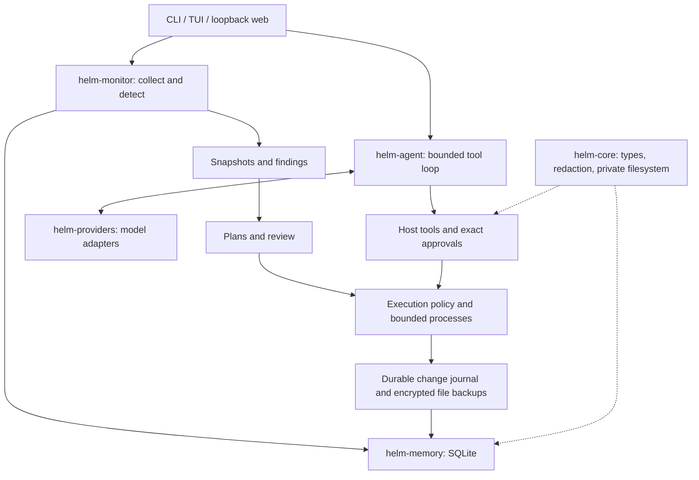

# HELM: usage and project presentation guide

HELMOPS (`helm` and `helmops`) combines Linux host monitoring, reviewed remediation,
and a bounded AI agent. Present it as an operations assistant with explicit human
approval and durable evidence. The independent results and remaining acceptance
gaps are in [VERIFICATION.md](VERIFICATION.md).

## 1. Explain the project in one minute

“Linux troubleshooting usually means collecting evidence with several commands,
interpreting it, changing a service or file, and checking whether the change worked.
HELM puts those stages into one workflow. Collectors gather observations, detectors
raise findings, and a planner proposes actions. The user reviews the exact operation.
Supported file changes retain encrypted recovery material and an audit trail.
The same program also runs a tool-using AI agent on a local project, with explicit
approvals, cancellation, session history, and step and time limits.”

The contribution is the integration and enforcement around tools: exact approvals,
honest unknown health, durable change records, and bounded agent execution. Avoid
claiming a new language model, complete attack prevention, or autonomous system repair.

## 2. Build and set up

Supported binary target: Linux x86-64. Build with Rust 1.89 or newer:

```sh
git clone https://github.com/Jatin-Mali/helm.git
cd helm
cargo build --release -p helm-cli
HELM="$PWD/target/release/helm"
"$HELM" --version
"$HELM" --help
"$HELM" init
"$HELM" doctor
```

`init` configures a provider/model and masks key entry. Keys persist only in
`$XDG_CONFIG_HOME/helm/secrets.toml` (default `~/.config/helm/secrets.toml`, mode
0600). Metadata lives in `config.toml`. Key precedence is command-line override,
secrets store, then environment. Environment keys are not silently saved on startup.
Never put a key on a presentation slide or paste it into a task.

Monitoring works without an LLM. Agent work needs a reachable provider and a model
that supports tool calls. See [providers.md](providers.md). For the existing Ollama
demo, check `ollama list` and use `gemma4:31b-cloud` only if it is available and
authenticated. That model runs in the cloud; a localhost Ollama URL does not make
its inference local. For offline inference, use a locally running tool-capable model.

Release installation is a separate route, requiring published assets:

```sh
curl -fsSL https://github.com/Jatin-Mali/helm/releases/latest/download/install.sh | sh
helm init
```

If assets are unavailable, use the source build above. The installer checks SHA-256
before replacing an existing binary. Do not promise a release asset exists solely
because the source compiles.

## 3. Everyday commands

Use `$HELM` below after the source build, or substitute installed `helm`.

| Goal | Command | What to inspect |
|---|---|---|
| Diagnose setup | `"$HELM" doctor` | Provider, binaries, storage and audit checks |
| Collect a snapshot | `"$HELM" snapshot --profile quick --json` | Timestamp, domains, collector errors |
| See findings | `"$HELM" monitor --format json` | `.findings` and `.coverage`; no findings does not imply healthy coverage |
| Continuous collection | `"$HELM" monitor --watch --interval 60` | Freshness and changes over time; Ctrl-C stops |
| Explain evidence | `"$HELM" explain FINDING_ID` | Evidence and affected resource |
| Generate a plan | `"$HELM" troubleshoot "investigate this finding" --from-finding FINDING_ID` | Commands, effects, risks and recovery limits |
| Apply a saved plan | `"$HELM" apply-plan PLAN_ID` | Approve or deny each exact step |
| Inspect changes | `"$HELM" change-set list` / `show CHANGE_ID` | Step outcome and verification status |
| Restore supported edits | `"$HELM" change-set rollback CHANGE_ID` | Restored bytes/mode/existence; errors remain visible |
| Check audit | `"$HELM" audit verify` | Chain result and head hashes |
| Export a runbook | `"$HELM" runbook --output /tmp/helm-runbook.md` | Snapshot-based operational report |
| Background monitoring | `"$HELM" daemon start`, `status`, `stop` | Heartbeat; stale is distinct from running |

`--read-only` blocks mutations; `--dry-run` previews execution. Observations can
still create local evidence records. `--sandbox` is currently refused: it must
not be presented as working isolation. Denying an apply-plan step may exit zero
while reporting it skipped; check the change outcome as well as the exit code.

### Terminal and web interfaces

```sh
"$HELM" tui
"$HELM" web --port 9120
```

For web, open the printed loopback URL and enter the terminal pairing code.
The code is single-use; the code and session expire after 15 minutes. Restart to
pair again. Keep the code out of screenshots. Service actions and rollback need
a separate review of the exact operation. Keep the dashboard on loopback.

### Agent workflow

```sh
"$HELM" --provider ollama --model gemma4:31b-cloud run \
  "Inspect this project, explain its structure, fix the failing test, run python3 -m unittest, and summarize evidence." \
  --workspace /path/to/demo-project --max-steps 20 --timeout-secs 300
"$HELM" run --sessions
"$HELM" run --resume SESSION_ID "continue"
```

Read and search stay within the workspace. Writes, shell, HTTP and browser calls
need exact single-use approval. A shell approval gives the command your OS
authority, including access outside the workspace. Without a terminal, a pending
approval stops the run. Ctrl-C cancels; resume does not replay unfinished effects.
Use `--budget-usd` only with explicit `--input-price` and `--output-price` values
(USD per million tokens). Bounds do not reverse already completed effects.

### Fleet and other integrations

```sh
"$HELM" remote add lab-a --host 192.0.2.10 --user demo
"$HELM" monitor --fleet --json
```

Replace the example address with an authorized SSH host running HELM. Fleet is
remote observation; general-agent tasks remain local. Unreachable hosts become
UNKNOWN with last-known data marked STALE. [agent-on-remote.md](agent-on-remote.md)
covers installation. Alerting supports Slack, PagerDuty and webhooks; pipeline
ingress supports signed GitHub, GitLab-token and generic timestamped-HMAC requests.
Mock delivery/signature tests do not prove delivery to a real external account.

## 4. Prepare a safe demonstration

Use a separate terminal with disposable state so your normal HELM data is untouched:

```sh
HELM="$PWD/target/release/helm"
DEMO_ROOT=$(mktemp -d /tmp/helm-presentation.XXXXXX)
export XDG_CONFIG_HOME="$DEMO_ROOT/config"
export XDG_DATA_HOME="$DEMO_ROOT/data"
export XDG_CACHE_HOME="$DEMO_ROOT/cache"
cp -R tests/demo/project "$DEMO_ROOT/project"
"$HELM" monitor --profile quick --format json
(cd "$DEMO_ROOT/project" && python3 -m unittest)
```

The initial project test is intentionally failing. Run the agent command from
section 3 against `"$DEMO_ROOT/project"`. Read every approval, then independently
rerun `python3 -m unittest` in that directory. Show the diff and saved session;
model prose alone is insufficient proof of a fix. Cancel with Ctrl-C if the model
stalls. Keep a recorded successful run available, labeled with its date and model.

For reproducible operations and recovery, use the supplied fixture:

```sh
python3 tests/demo/ops.py "$HELM" "$DEMO_ROOT/ops"
```

It starts a harmless loopback HTTP fixture, observes HTTP 500, denies a marker step,
approves a reversible configuration edit, verifies HTTP 200, restores the original
file, and checks refusal to overwrite a newer edit. Its plan is inserted as a
deterministic test fixture; this scenario does not demonstrate live AI plan generation.

Run the complete integration harness before presenting:

```sh
HELM_DEMO_PROVIDER=ollama HELM_DEMO_MODEL=gemma4:31b-cloud \
  bash scripts/verify-demo.sh --strict --soak-minutes 10
```

It needs Docker, SSH tooling, Chromium/Chrome, Python, build dependencies, and the
real provider. It builds an old revision for upgrade testing, which can take time.
UNVERIFIED is not PASS; strict mode fails unavailable integrations. Docker fixtures
use reserved names `helm-demo-a` / `helm-demo-b`; do not use those names for other
containers. Run this before the meeting, not during the timed presentation.
Stop any daemon you started with `"$HELM" daemon stop` before discarding demo state.

## 5. A 12-minute presentation to your project guide

| Time | Show | Explain |
|---|---|---|
| 0–1 min | Problem and one-minute introduction | Evidence collection, interpretation and safe change management are separate steps |
| 1–3 min | Architecture diagram below | What is deterministic, where the model contributes, where authorization is enforced |
| 3–5 min | Monitor JSON and one finding | Severity, evidence, freshness, and why UNKNOWN matters |
| 5–7 min | Operations fixture output and change-set record | Denied step absent; approved file changes; verification and recovery |
| 7–10 min | Temporary-project agent and independent test rerun | Native tool calls, exact approval, bounded loop, evidence-based result |
| 10–11 min | Web pairing or TUI | Same execution boundaries, distinct UI workflows |
| 11–12 min | Verification report and remaining work | Test evidence, actual limits, next acceptance work |



Code tour: `helm-cli/src/main.rs` wires commands; `crates/helm-monitor/src/execute.rs`
checks plans; `process_runner.rs` bounds processes; `helm-cli/src/execution_journal.rs`
records changes; `crates/helm-agent/src/runtime.rs` runs the agent;
`crates/helm-agent/src/tools.rs` controls tool access; `helm-cli/src/web_auth.rs`
handles browser sessions; `crates/helm-core/src/secret.rs` redacts sensitive text.

## 6. Likely questions and accurate answers

**Why Rust?** Typed shared models, async I/O, and explicit process/filesystem control
fit a host tool. Rust does not by itself prevent authorization or logic bugs.

**Why use an LLM?** For explanations and multi-step tool selection. Collectors,
detectors, schema validation, approvals, process limits and recovery remain host code.

**How is this different from a chat interface?** It records actual tool outcomes,
requires exact approvals for sensitive calls, bounds execution, and stores sessions
and change evidence. A suggested command is distinguishable from an executed one.

**Can prompt injection authorize a write?** Retrieved content cannot grant authority.
Host checks still require an operator decision. A malicious suggestion can still
mislead a human; approval is not a guarantee that a command is safe.

**Can every change be rolled back?** No. Supported regular-file changes have
authenticated encrypted backups. Arbitrary shell side effects require manual
recovery. Newer edits, missing keys and corrupt backups make restoration fail visibly.

**Is the audit tamper-proof?** No. It is an unkeyed SHA-256 chain, with legacy-row
compatibility. A same-user attacker can rewrite it. Keep head hashes off-host for
stronger tamper evidence. Redaction is pattern-based, not a guarantee of anonymity.

**Is the project complete?** Use the current [independent report](VERIFICATION.md).
Implementation and automated coverage differ from fresh-machine acceptance.
Containers are not a fresh VM; a short soak is not multi-day reliability evidence.
Only label providers and integrations live-tested when they actually ran.

**What comes next?** A fresh supported VM with a disposable real service; longer
target-hardware soak; additional live providers; and any deferred sandbox or remote
agent work as separately scoped features. These are future work, not demo claims.
